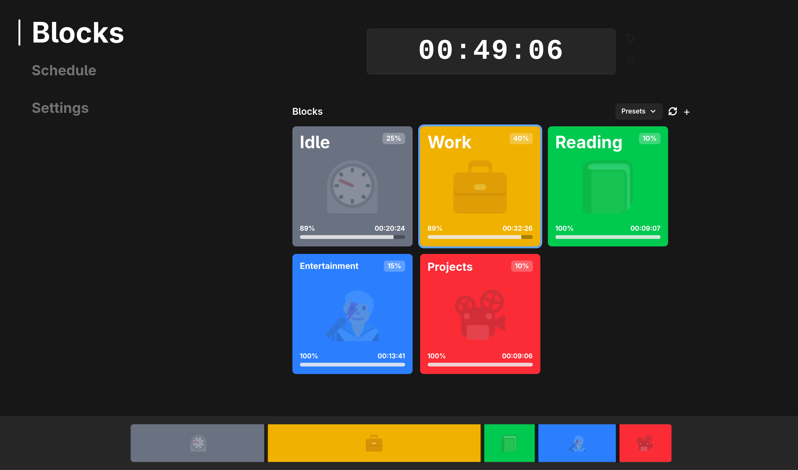

<p align="center">
  
</p>

<h1 align="center">Blocks</h1>

A desktop time management app built to always keep you productive. Pick the time you want to log off, then split the hours until then into **blocks**: chunks of your remaining time, each with its own budget, that count down as you work. Set specific goals or time limits for different tasks throughout your day, so there's no space for meandering.

 Hit your goals and break bad habits with Blocks.

Built with [Tauri 2](https://tauri.app), React 19, TypeScript, and Tailwind CSS 4.

<p align="center">
  
</p>

## How it works

### 1. Set your log-off time

The timer at the top is your day's hard stop:

- Set the time with the hour/minute spinners, by typing, or with the ±30m / 1h / 90m / 2h quick-adjust buttons.
- The timer can also pre-fill itself from a saved schedule, whether that's a global default, a day-specific override, or an exact-date override.
- 12-hour and 24-hour formats both supported.

### 2. Divide it into blocks

Below the timer, allocate 100% of the remaining time across blocks, such as *Idle*, *Work*, *Gaming*, whatever your day looks like:

- Each block has a name, emoji, color, and a percentage of the total time.
- Drag the divider handles on the **muxer bar** to trade time between neighboring blocks, or use each block's slider.
- Set a block as 👍 good or 👎 bad to mark it as a goal or a distraction.
- Save block layouts as named **presets** and reload (or delete) them from the Presets menu.

You can't start the timer until the full 100% is allocated. Time only counts against the selected block. 

### 3. Begin your day

Hit **Start** and the countdown begins:

- The active block's time ticks down; when it runs out you get a system notification, a completion sound, and for good blocks, confetti.
- When a timer or block hits zero, it goes into **overtime**, counting into the negatives. Whether that's good or bad depends on the block's rating, but either way the overshoot stays visible, so you know exactly where your time is going.
- App state is saved continuously. Quit and relaunch mid-countdown and the timer resumes where it should be.

### Misc.

- **Theme** - Light or dark mode, matching your system by default.
- **Sounds** - Pick a sound for each block and timer completion, or upload your own.

## Development

### Prerequisites

- [Node.js](https://nodejs.org) and [pnpm](https://pnpm.io)
- [Rust](https://rustup.rs) (stable)
- Tauri's [platform dependencies](https://tauri.app/start/prerequisites/) (WebKitGTK etc. on Linux)

### Build

```sh
pnpm tauri build
```

## Project layout

```
src/
  App.tsx               # State ownership, autosave, theme resolution, page routing
  Schedule.tsx          # Log-off schedule page (weekday/date overrides)
  Settings.tsx          # Theme, time format, and sound settings
  components/
    Timer.tsx           # Log-off timer: picker, countdown, overtime
    BlockManager.tsx    # Block grid, presets, completion detection
    Block.tsx           # A single block card
    Muxer.tsx           # Drag bar for redistributing percentages
  lib/
    appState.ts         # State types, defaults, load/save + normalization
    logOffSchedule.ts   # Schedule resolution (next log-off date)
    completionSounds.ts # Built-in + custom sound resolution
    notifications.ts    # System notifications via Tauri
src-tauri/
  src/app_state.rs      # Persisted state (JSON in the app data dir)
  src/notifications.rs  # Notification permission + delivery
```
